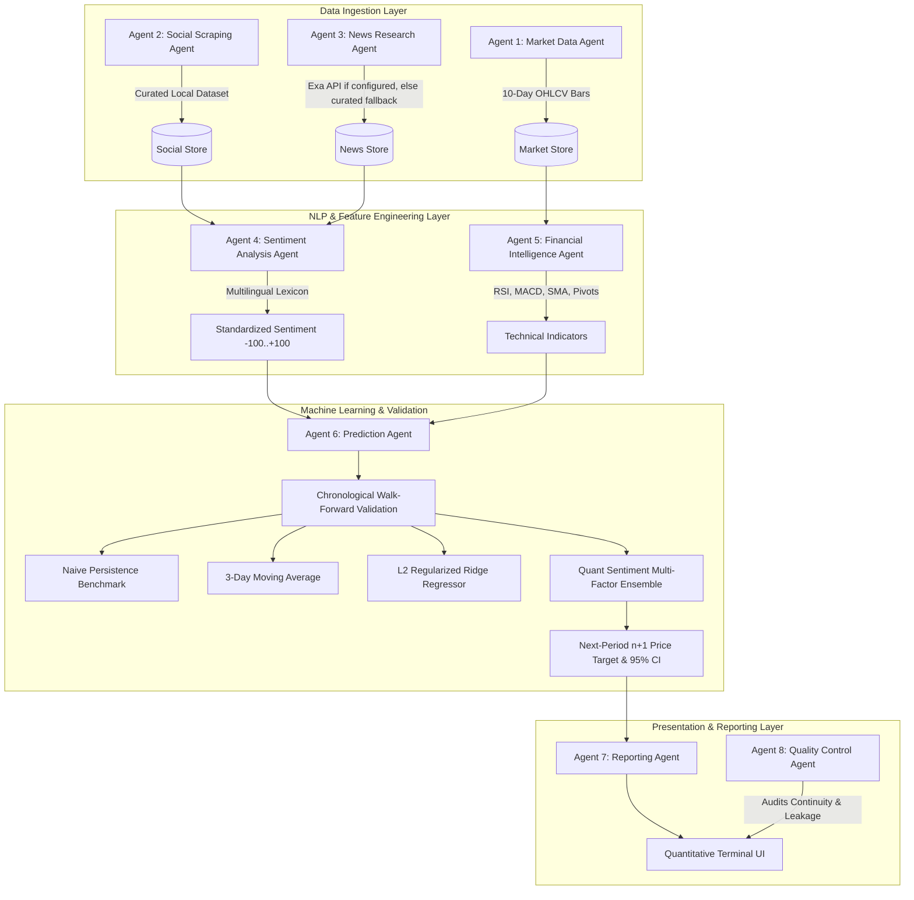

# HengSeng Sentiment Price Prediction Agent

> **AI-Powered Financial Sentiment Intelligence & Next-Period (n+1) Price Prediction Platform for Hong Kong (HKEX) and South Korea (KRX) Exchanges.**

---

## 1. Executive Summary

**HengSeng Sentiment Price Prediction Agent** is an enterprise-grade quantitative research platform that transforms unstructured multilingual social media discussions and financial news into structured, explainable financial alpha signals and next-period $(n+1)$ price forecasts.

The platform continuously tracks a universe of 10 liquid flagship assets across two major Asian exchanges:
- **Hong Kong Exchange (HKEX)**: Tencent (`0700.HK`), Alibaba (`9988.HK`), HSBC (`0005.HK`), Meituan (`3690.HK`), Xiaomi (`1810.HK`).
- **Korea Exchange (KRX)**: Samsung Electronics (`005930.KS`), SK Hynix (`000660.KS`), NAVER (`035420.KS`), Kakao (`035720.KS`), Hyundai Motor (`005380.KS`).

Social intelligence is served from a curated multilingual local dataset covering LIHKG, Telegram, Naver Finance Jongmok Toronbang, Daum Finance, and Futu/Moomoo. News comes from the **Exa Neural Search API** when `EXA_API_KEY` is configured; otherwise a curated local fallback dataset is used. Features are synthesized with technical price indicators into a chronological Walk-Forward Machine Learning pipeline that forecasts the next session's closing price without lookahead leakage.

---

## 2. System Architecture



---

## 3. Core Features

1. **Exchange-Wise Cross-Sectional Ranking Table**: Sortable and filterable by mentions, sentiment polarity, price change, predicted price, and predicted drift.
2. **Multilingual Financial NLP**: Real-time parsing of Traditional Chinese (HK Cantonese slang like "破頂", "看好", "撈底"), Korean ("풀매수", "신고가", "외인매수"), and English financial jargon.
3. **Logarithmic Engagement Weighting**:
   $$\text{Engagement} = \log_{10}(1 + \text{likes} \cdot 1.0 + \text{comments} \cdot 2.0 + \text{shares} \cdot 3.0 + \text{views} \cdot 0.05)$$
4. **Strict Walk-Forward Out-of-Sample Validation**: Expanding chronological test window ensuring zero lookahead data leakage.
5. **Technical Levels & Pivots**: Floor Trader Pivot Points ($P, R_1, R_2, S_1, S_2$) and 10-day rolling swing highs and lows.
6. **Autonomous Multi-Agent Orchestrator**: Agents 1 through 8 coordinating market feeds, curated social data, optional Exa queries, NLP, ML forecasting, and QC verification. Agent throughput, durations, and quality scores are computed from current repository state at runtime.
7. **News Discovery Engine**: Relevance-weighted financial news discovery. LIVE Exa search is used when a key is configured; otherwise the UI and API explicitly label the curated fallback source.
8. **Automated Executive Briefings**: One-click generation of PDF printable reports and CSV data export.

---

## 4. Technology Stack

- **Frontend**: React 19, TypeScript, Vite, Tailwind CSS v4, Recharts, Lucide Icons.
- **Full-Stack Dev Server**: Node.js, Express, `tsx`, Vite Dev Middleware.
- **Python Backend Engine** (optional, not required by the app): Python 3, FastAPI, Pydantic, Scikit-learn, NumPy. Serves reference endpoints only; the canonical metrics come from the Node engine.
- **Persistence**: In-memory seeded stores (deterministic OHLCV + curated social/news observations). No PostgreSQL or Redis is used or required.
- **External Integrations**: Exa Search API (optional, enabled only when `EXA_API_KEY` is set; otherwise the curated news dataset is served). No Apify client and no Yahoo Finance client exist in this codebase — social data comes from the curated multilingual local dataset and market data from the deterministic OHLCV generator.

---

## 5. Required Credentials & Configuration

Copy `.env.example` to `.env` and configure:

| Variable | Description | Source |
| :--- | :--- | :--- |
| `EXA_API_KEY` | Optional. Enables live Exa news search (per-asset) during agent runs; without it the curated news dataset is served | [dashboard.exa.ai](https://dashboard.exa.ai/api-keys) |

*No credentials are required to run the platform. Without `EXA_API_KEY` everything operates from the curated 10-day historical observations, deterministic OHLCV market data, and walk-forward ML models. `GET /api/v1/sources/status` reports, per source, whether records are LIVE or LOCAL FALLBACK.*

---

## 6. How to Run the Platform

### Running the Live Full-Stack Applet (Node.js / Express / Vite)
```bash
# 1. Install dependencies (peer conflicts exist between root esbuild and vite -> use legacy-peer-deps)
npm install --legacy-peer-deps

# 2. Run the development fullstack server (Port 3000)
npm run dev
```
Open [http://localhost:3000](http://localhost:3000) in your browser.

### Verification Suites
```bash
npm run lint                      # tsc --noEmit
python -m unittest backend.tests.test_pipeline -v   # 3 unit tests
node scripts/audit_api.cjs        # 24 endpoint contract checks
node scripts/audit_error_handling.cjs              # 404/error contract checks
node scripts/audit_responsive.cjs                  # 10-viewport UI screenshots
npm run build                     # vite build
```

### Running with Docker & Docker Compose
```bash
cd backend
docker-compose up --build -d
```

---

## 7. Machine Learning Model Leaderboard

Measured via out-of-sample walk-forward cross-validation across all 10 monitored assets
(5 chronological folds × 10 assets = 50 out-of-sample observations per model).
Figures below are the values returned by `GET /api/v1/predictions/performance` at the
time of writing — query the endpoint for the live numbers:

| Model Architecture | Dir. Acc. | MAPE % | MAE (HKEX, HKD) | MAE (KRX, KRW) | OOS R² | Status |
| :--- | :---: | :---: | :---: | :---: | :---: | :--- |
| Multi-Factor Quant Sentiment Ensemble | 48% | 1.07% | 2.27 | 1017.15 | -2.100 | Deployed production model |
| Naive Persistence Baseline ($P_{n+1} = P_n$) | 36% | 0.88% | 1.52 | 1062.09 | -0.801 | Benchmark |
| Historical 3-Day Moving Average | 46% | 1.39% | 2.36 | 1681.20 | -3.673 | Benchmark |
| Linear / Ridge Regression ($L_2$) | 50% | 1.29% | 3.30 | 1057.00 | -5.737 | Challenger |

**Honest reading of these results:** the deployed ensemble is not the best model on every
metric. Ridge has the highest directional accuracy (50%), while the persistence baseline
still has the lowest MAPE and the least-negative R². The ensemble is labeled "production"
because it is the deployed multi-factor model, not because it won a champion-selection
process. R² is reported without clipping at -1, so strongly negative values are visible.
These are the real measurements from 5 walk-forward folds per asset (50 OOS observations
per model) on a 10-bar history — a very small sample. No metric on any screen or in this
file is hand-written.


---

## 8. Scientific Honesty & Limitations Disclosure

Financial markets are complex, non-stationary adaptive systems. Social media sentiment is subject to noise, coordinated retail manipulation ("meme" runs), and sarcasm. Point forecasts are experimental model projections and do not constitute financial advice. The platform provides 95% confidence intervals and historical directional hit-rates to reflect statistical uncertainty honestly.

Additional scope limits in this build:

- **Small sample:** each asset has 10 daily bars, yielding 5 walk-forward folds per asset (50 OOS observations total). Results are unstable and not suitable for live capital allocation.
- **RSI period:** with only 10 bars, the UI labels the adaptive period actually used (e.g., 9-period) instead of claiming a 14-period RSI. MACD is computed with limited history and is not included in the model feature vector.
- **Social data:** the Apify actor runner is not implemented. Social records always come from the curated local dataset, even if an Apify token is stored in Settings.
- **Market data:** OHLCV bars come from a deterministic seeded generator, not a live Yahoo/vendor feed. The Data Registry labels this as `local-fallback`.
- **News data:** Exa is live only when `EXA_API_KEY` is configured; otherwise the curated fallback dataset is used and labeled as such.
- **Production model vs. best model:** the deployed ensemble may underperform a baseline on some metrics. See the Model Validation screen for current values.
